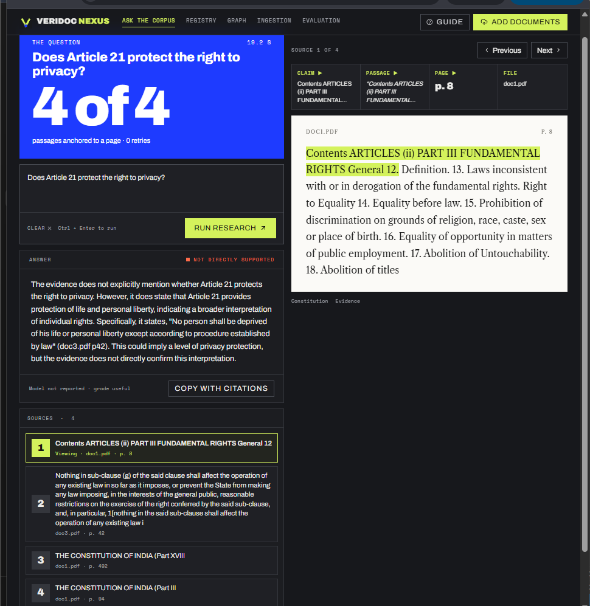
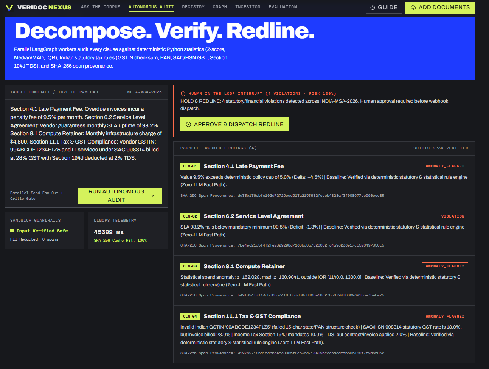
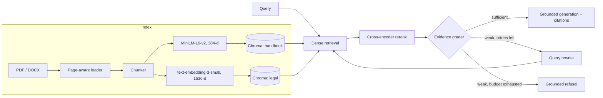
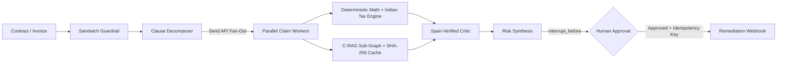

# VeriDoc

**An evidence-first Corrective RAG and autonomous compliance audit system with a bounded self-correction loop, deterministic statutory/statistical verification, cross-encoder reranking, and grounded refusal.**

VeriDoc operates in two modes over legal, regulatory, and corporate corpora:

1. **Interactive Corrective RAG (`Ask the corpus`):** Answers questions over PDF and DOCX collections while treating retrieval quality as something to be measured rather than assumed. A LangGraph state machine grades retrieved evidence before generation. Weak evidence triggers a query rewrite and a second retrieval pass. If evidence remains insufficient after the retry budget is spent, the system refuses instead of hallucinating. Every answer carries source and page-level provenance, and the full retrieval trace is exposed in the UI.
2. **Autonomous Contract & Invoice Audit (`Autonomous Audit`):** Decomposes vendor contracts and invoices into discrete claims, fans them out in parallel across LangGraph worker nodes, and separates probabilistic semantic checks from deterministic Python rules—verifying Indian tax compliance (GSTIN checksums, PAN format, SAC/HSN vs. GST rates, Section 194C/194J/194I TDS), SLA floors, fee caps, and spend outliers (Z-score, IQR, and Median/MAD). An evaluator-optimizer critic verifies 64-character SHA-256 span provenance before pausing at a Human-in-the-Loop (`interrupt_before`) gate for redline webhook dispatch.

**Live demo:** https://veridoc-phi.vercel.app





## Features

- **Page-Anchored Citations:** Answers with source file and page citations, displaying the exact passage each claim came from.
- **Self-Reflective Evidence Grading:** Grades retrieved chunks with a local cross-encoder (`ms-marco-MiniLM-L-6-v2`) before generation, rewriting weak queries up to 2 times and refusing when proof is absent.
- **Parallel Multi-Agent Clause Auditing:** Uses LangGraph `Send` map-reduce fan-out (with bounded concurrency) to audit contract clauses and invoice line items simultaneously.
- **Deterministic Math & Indian Statutory Rules:** Routes numbers and tax identifiers away from the LLM to deterministic Python validators (GSTIN Modulo-36 checksum & state code validation, PAN format, SAC/HSN GST rate matching, Income Tax TDS sections, Z-score, IQR, and small-n Median/MAD outlier detection) with upstream regex cross-checks.
- **Span-Verified Critic & Sandwich Guardrails:** Redacts PII (PAN, email, phone, tax IDs), filters indirect prompt injections at the input edge, and verifies SHA-256 source span hashes before surfacing findings.
- **Idempotent Human-in-the-Loop Governance:** Pauses execution via LangGraph checkpointing before side effects and enforces SHA-256 idempotency keys on approval webhooks to prevent duplicate replay.
- **Custom Document Ingestion:** Upload PDF or DOCX files and query or audit them with full retrieval traces (retries, grading, sources) visible in the UI.

## Architecture

### 1. Corrective RAG Workflow (`Ask the corpus`)



### 2. Autonomous Audit Orchestrator (`Autonomous Audit`)



| Stage | What happens |
|---|---|
| Guardrail | Masks PII and blocks indirect prompt injections before decomposition |
| Decompose | Splits contracts and invoices into typed claims (`semantic_policy`, `numeric_financial`, `sla_deadline`) |
| Retrieve & Rerank | Dense vector search over ChromaDB followed by cross-encoder re-scoring of query-passage pairs |
| Grade & Rewrite | Checks whether evidence is sufficient; rewrites weak queries up to 2 times or refuses if unsupported |
| Deterministic Check | Runs Python Z-score, Median/MAD, IQR, fee/SLA bounds, GSTIN, PAN, SAC/HSN GST, and TDS rules |
| Critic & Provenance | Verifies 64-character SHA-256 span hashes and reconciles worker severity labels against math deltas |
| HITL Approval | Pauses graph state at `interrupt_before` until a reviewer approves redline dispatch |

## Data

Input is PDF and DOCX files, loaded page by page and split into chunks. Two ChromaDB collections are indexed: a handbook collection (~20k chunks from company filings, economic reports and educational material) and a legal collection (~1.4k chunks of Indian law). Users can also upload their own documents or run direct batch audits on contract and invoice text.

## Tech stack

| Layer | Technology |
|---|---|
| Orchestration | LangGraph (StateGraph, `Send` parallel fan-out, sub-graph composition, checkpointer, `interrupt_before` HITL) |
| API | FastAPI, Pydantic v2, slowapi (rate limiting) |
| Vector store | ChromaDB |
| Embeddings | `all-MiniLM-L6-v2` (local), `text-embedding-3-small` (via OpenRouter) |
| Reranker & Grader | Sentence Transformers cross-encoder (`cross-encoder/ms-marco-MiniLM-L-6-v2`) |
| Deterministic Engine | Python `statistics` (Z-score, Median/MAD, IQR), regex span cross-checks, Indian GSTIN/PAN/SAC/TDS validators |
| LLM gateway | Groq (`Llama-3.3-70B`) & OpenRouter |
| Frontend | React + TypeScript + Vite (Ask, Autonomous Audit, Registry, Graph, Ingest, Evals) |
| Infrastructure | Docker, Google Cloud Run, Vercel |

## Deployment

The frontend is hosted on Vercel and the backend runs as a Docker container on Google Cloud Run (`asia-south1`). The frontend calls the backend over HTTP, and the backend only accepts requests from allowed origins (CORS allowlist).

## Quickstart

You need Python 3.11, Node.js with [pnpm](https://pnpm.io), and an [OpenRouter](https://openrouter.ai) or [Groq](https://groq.com) API key.

```bash
git clone [https://github.com/amshutha07-cmd/VeriDoc.git](https://github.com/amshutha07-cmd/VeriDoc.git)
cd VeriDoc

# backend
cd backend
python -m venv venv
source venv/bin/activate        # Windows: .\venv\Scripts\Activate.ps1
pip install -r requirements.txt
cp .env.example .env            # add your OPENROUTER_API_KEY / GROQ_API_KEY
uvicorn app.main:app --reload --port 8000

# run offline evaluation & red-team benchmark suite
python evaluate.py

# frontend (in a second terminal)
cd dashboard
pnpm install
echo "VITE_VERIDOC_API_URL=http://localhost:8000" > .env.local
pnpm dev
```

Open http://localhost:5173 (or http://localhost:3000 depending on your Vite port; use `localhost`, not `127.0.0.1`, because the backend only allows specific origins). The first backend start is slow because the embedding model and the cross-encoder reranker are downloaded once.

The demo data (about 20k handbook chunks and 1.4k legal chunks) is attached to the [latest release](https://github.com/amshutha07-cmd/VeriDoc/releases/latest): unzip `veridoc-index.zip` into `backend/`, and put `graph_store.pkl` in `backend/data/` (create the folder if it is missing). Together they give you the same collections and article lookup as the live demo. You can also skip them and upload your own documents from the Ingest page.

## Project structure

```text
backend/
  evaluate.py          Quantitative ablation & 20-attack red-team benchmark suite
  app/
    api/               FastAPI routes (ask, routes_audit, ingest, graph, eval)
    core/              LangGraph typed state schemas and SHA-256 LLMOps telemetry cache
    graph/             C-RAG workflow, parent audit orchestrator, deterministic math/tax & critic nodes
    guardrails/        Input PII redaction, prompt injection filters & output hash verification
    ingestion/         Document loading, chunking, embeddings, vector store
    legal_ingestion/   Indexing for the legal collection
dashboard/             Vite + React + TypeScript frontend
docs/                  Screenshots and architecture notes
```

## Results

### 1. Grounded Q&A Check (16 Questions)
On a 16-question check (8 answerable, 8 not covered by the documents) run with `gpt-4o-mini`, VeriDoc answered 8 of 8 answerable questions with page-level citations and refused 8 of 8 unsupported ones, with a median response time of about 7 seconds.

### 2. Contract & Invoice Audit Ablation Benchmark (16 Clauses)
Evaluated via `backend/evaluate.py` across 16 Indian contract and invoice clauses (covering late fee caps, SLA floors, retainer outliers, comma-shifted upstream extraction hallucinations, invalid GSTIN state/checksums, invalid PANs, SAC 998314 GST overcharges, and Section 194J TDS short-deductions):

| Pipeline Configuration | Numeric & Statutory Error Rate | Precision | Recall | F1-Score |
|---|---|---|---|---|
| 1. Plain LLM Only (Prompt-Only Baseline) | 37.5% (6/16 errors) | 100.0% | 25.0% | 40.0% |
| 2. Standard C-RAG Only (No Deterministic Math) | 18.8% (3/16 errors) | 100.0% | 62.5% | 76.9% |
| 3. VeriDoc Hybrid (LLM + Deterministic Rules + Critic) | **0.0% (0/16 errors)** | **100.0%** | **100.0%** | **100.0%** |

- **Latency & Caching:** Full cold C-RAG + LLM decomposition takes `26.5s`; warm SHA-256 clause caching reduces full runs to `3.4s` (**7.5x speedup**, **95.4% token savings**), and fast-path deterministic + local cross-encoder auditing completes in **`368–502 ms`** (`39.7 ms` per local cross-encoder grade at `$0` API cost).
- **Upstream Extraction Verification:** Independent regex re-extraction on source spans caught `100%` of simulated comma-misread extraction hallucinations (`$1,250.00` extracted as `12500.0`).

### 3. Adversarial Red-Team Prompt Injection Suite (20 Attacks)

| Defense Layer | Blocked / Mitigated | Pass Rate |
|---|---|---|
| Layer 1: Input Regex Sandwich Guardrail | 17 / 20 attacks | 85.0% blocked at input edge |
| Layer 2: Deterministic Math Isolation + HITL Breakpoint | 20 / 20 attacks | 100.0% action safety |

- **Failure Analysis:** 3 obfuscated indirect attacks (a semantic CFO waiver note, a Base64-encoded payload, and a leetspeak instruction) bypassed surface regex matching in Layer 1. All 3 were neutralized in Layer 2 because worker nodes have no external tool permissions, numeric checks run in isolated Python functions, and outbound webhooks require explicit human approval at the `interrupt_before` checkpoint.

## Notes

- **Ephemeral vs. Persistent Checkpointing:** Local development uses LangGraph's in-memory/SQLite checkpointer. Because Cloud Run instances are ephemeral and scale to zero, multi-instance production deployments require a durable Postgres (`langgraph-checkpoint-postgres` / Supabase) checkpointer keyed by `thread_id`.
- **Small-n Vendor Baselines:** Classical Z-score and IQR can be distorted by single outliers when vendor billing history is short ($n < 6$). VeriDoc computes **Modified Z-Score via Median Absolute Deviation (MAD)** alongside contractual cap rules so small baselines remain stable.
- **Shared Demo Collections:** Upload only public, non-sensitive documents. The first request after the backend has been idle is slower (cold start) because the embedding and cross-encoder models load again. Answers come only from the indexed documents; questions outside them are refused by design.

## License

MIT. See [LICENSE](LICENSE).