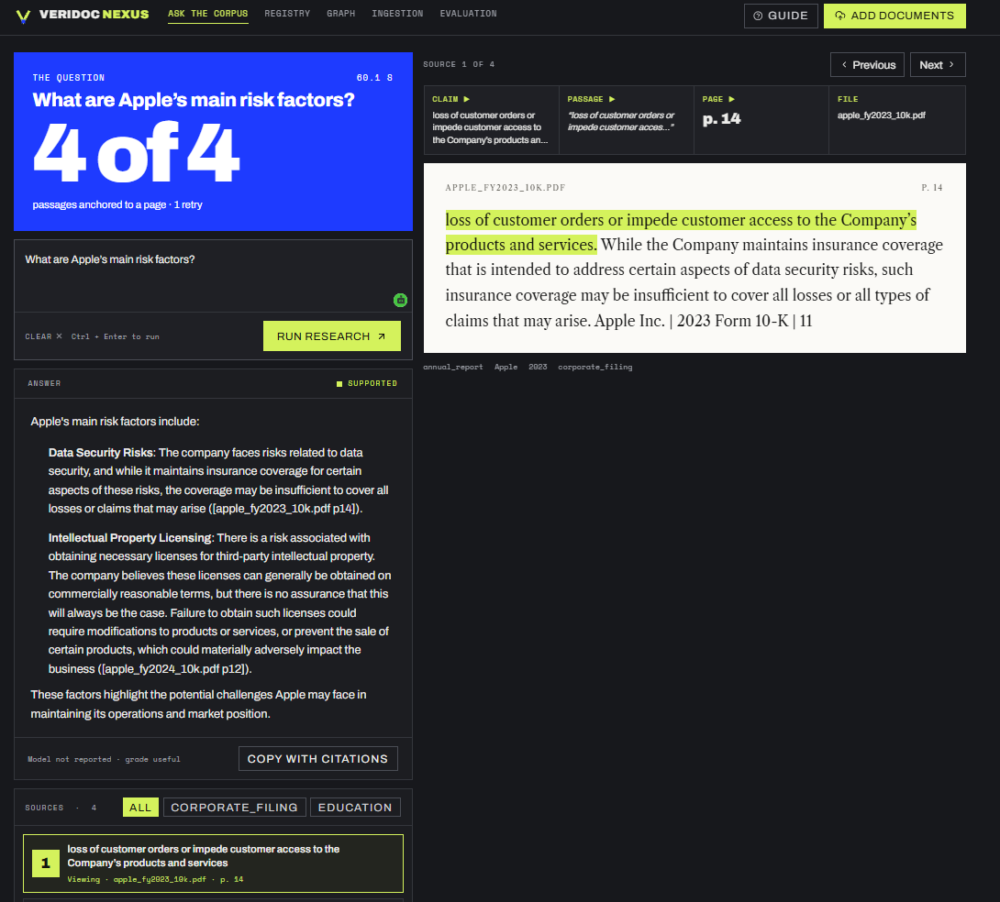
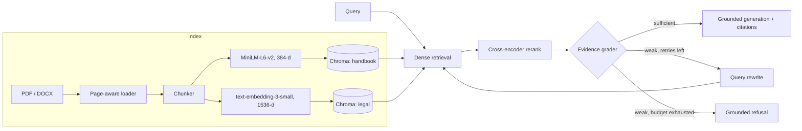

# VeriDoc

**An evidence-first Corrective RAG system with a bounded self-correction loop, cross-encoder reranking and grounded refusal.**

VeriDoc answers questions over PDF and DOCX corpora, and it treats retrieval quality as something to be measured rather than assumed. A LangGraph state machine grades the retrieved evidence before generation. Weak evidence triggers a query rewrite and a second retrieval pass. If the evidence is still insufficient after the retry budget is spent, the system refuses instead of hallucinating. Every answer carries source and page-level provenance, and the full retrieval trace is exposed in the UI.

**Live demo:** https://veridoc-phi.vercel.app



## Features

- Answers with source file and page citations, and shows the passage each claim came from
- Grades its own evidence before answering
- Rewrites weak queries and retries (up to 2 times)
- Refuses when the documents don't support the question
- Upload your own PDF or DOCX files and ask questions about them
- Shows the full retrieval trace (retries, grading, sources) in the UI

## Architecture



| Stage | What happens |
|---|---|
| Retrieve | Dense vector search over ChromaDB for candidate chunks |
| Rerank | A cross-encoder re-scores each query-passage pair and keeps the best few |
| Grade | Checks whether the evidence is actually enough to answer |
| Rewrite | Rewrites the query and retries, up to 2 times |
| Generate | Answers only from the evidence, with source and page citations |
| Refuse | Says the question isn't supported if proof still isn't found |

## Data

Input is PDF and DOCX files, loaded page by page and split into chunks. Two ChromaDB collections are indexed: a handbook collection (~20k chunks from company filings, economic reports and educational material) and a legal collection (~1.4k chunks of Indian law). Users can also upload their own documents.

## Tech stack

| Layer | Technology |
|---|---|
| Orchestration | LangGraph |
| API | FastAPI, slowapi (rate limiting) |
| Vector store | ChromaDB |
| Embeddings | all-MiniLM-L6-v2 (local), text-embedding-3-small (via OpenRouter) |
| Reranker | Sentence Transformers cross-encoder |
| LLM gateway | OpenRouter |
| Frontend | React + Vite (Ask, Registry, Graph, Ingest, Evals) |
| Infrastructure | Docker, Google Cloud Run, Vercel |

## Deployment

The frontend is hosted on Vercel and the backend runs as a Docker container on Google Cloud Run (`asia-south1`). The frontend calls the backend over HTTP, and the backend only accepts requests from allowed origins (CORS allowlist).

## Quickstart

You need Python 3.11, Node.js with [pnpm](https://pnpm.io), and an [OpenRouter](https://openrouter.ai) API key.

```bash
git clone https://github.com/amshutha07-cmd/VeriDoc.git
cd VeriDoc

# backend
cd backend
python -m venv venv
source venv/bin/activate        # Windows: .\venv\Scripts\Activate.ps1
pip install -r requirements.txt
cp .env.example .env            # add your OPENROUTER_API_KEY
uvicorn app.main:app --reload --port 8000

# frontend (in a second terminal)
cd dashboard
pnpm install
echo "VITE_VERIDOC_API_URL=http://localhost:8000" > .env.local
pnpm dev
```

Open http://localhost:5173 (use `localhost`, not `127.0.0.1`, because the backend only allows specific origins). The first backend start is slow because the embedding model and the reranker are downloaded once.

The demo data (about 20k handbook chunks and 1.4k legal chunks) is attached to the [latest release](https://github.com/amshutha07-cmd/VeriDoc/releases/latest) as `veridoc-index.zip`. Unzip it into `backend/` to get the same collections as the live demo, or skip it and upload your own documents from the Ingest page.

## Project structure

```
backend/app/
  api/               FastAPI routes (ask, ingest, graph, eval)
  graph/             LangGraph workflow and nodes (retrieve, rerank, grade, rewrite, generate)
  ingestion/         Document loading, chunking, embeddings, vector store
  legal_ingestion/   Indexing for the legal collection
dashboard/           Vite + React frontend
docs/                Screenshots
```

## Notes

- Upload only public, non-sensitive documents. Uploaded files are indexed into the shared collections.
- The first request after the backend has been idle is slower (cold start), because the models load again.
- Answers come only from the indexed documents. Questions outside them are refused by design.

## License

MIT. See [LICENSE](LICENSE).