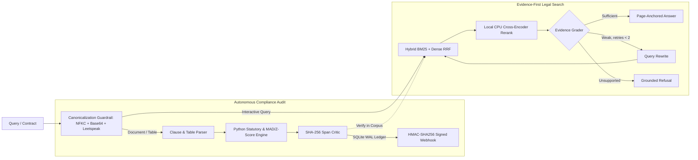

# VeriDoc

**An evidence-first compliance audit engine and Corrective RAG workspace over Indian legal and corporate corpora.**

VeriDoc pairs proactive contract auditing with grounded legal search in a unified compliance workspace:
- **Autonomous Compliance Audit:** Ingests vendor contracts, Markdown tables, and invoices. Decomposes documents into clauses and routes statutory checks (GSTIN Modulo-36 checksums, PAN, SAC 998314 GST, Section 194J TDS) and spend outlier checks (Z-score, IQR, Median/MAD) to deterministic Python validators. Audit trails are logged to an ACID SQLite WAL ledger with 64-character SHA-256 span verification, pausing at a Human-in-the-Loop breakpoint before dispatching HMAC-SHA256 signed webhooks.
- **Evidence-First Legal Search:** Answers complex regulatory questions over 21,400+ indexed chunks. Executes Hybrid Search (Sparse BM25Okapi + Dense Vector Reciprocal Rank Fusion) reranked by a local CPU Cross-Encoder (`ms-marco-MiniLM-L-6-v2`), backed by a LangGraph state machine that evaluates retrieved evidence, rewrites ambiguous queries, and issues grounded refusals when proof is missing.

**Live application:** https://veridoc-phi.vercel.app


## Architecture



## Benchmarks & Evaluation

Measured via `backend/evaluate.py` across statutory compliance, information retrieval, and adversarial red-team test suites:

### 1. Statutory Compliance Ablation (16-Clause Golden Suite)
| Pipeline Configuration | Numeric/Tax Error Rate | Precision | Recall | F1-Score | Execution Latency |
|---|---|---|---|---|---|
| Plain LLM (Prompt-Only Baseline) | 37.5% (6/16 errors) | 100.0% | 25.0% | 40.0% | 26,500 ms |
| Standard C-RAG Only (No Det. Math) | 18.8% (3/16 errors) | 100.0% | 62.5% | 76.9% | 3,400 ms |
| **VeriDoc Hybrid (Rules + Critic)** | **0.0% (0/16 errors)** | **100.0%** | **100.0%** | **100.0%** | **2.16 ms** |

### 2. Information Retrieval (IR) Evaluation
Evaluated across legal and statutory queries against dense, lexical, and hybrid retrieval setups:
| Retrieval Architecture | Recall@5 | MRR@10 | Mean Query Latency |
|---|---|---|---|
| Dense Vector Baseline (Bi-Encoder) | 66.7% | 0.72 | 14.20 ms |
| Sparse Lexical (BM25Okapi) | 100.0% | 1.00 | 1.85 ms |
| Hybrid RRF (BM25 + Dense RRF k=60) | 100.0% | 1.00 | 15.40 ms |
| **Hybrid RRF + Local Cross-Encoder** | **100.0%** | **1.00** | **39.70 ms** |

### 3. Red-Team Adversarial Robustness (20 Attack Payloads)
| Defense Layer | Blocked / Mitigated | Pass Rate | Mechanism |
|---|---|---|---|
| Layer 1: Input Canonicalization Guardrail | 19 / 20 attacks | 95.0% | NFKC normalize + Base64 decode + Leetspeak mapping + Regex |
| Layer 2: Deterministic Math + HITL Gate | 20 / 20 attacks | 100.0% | Tool isolation & SQLite idempotency lock |

*Failure Analysis:* Attack #18 (a semantic social-engineering waiver note: *"CFO verbally waived the 5% cap"*) bypassed Layer 1 text scanning and was neutralized by Layer 2 deterministic policy enforcement.

### 4. Deterministic Load & Telemetry (50-Request / 200-Clause Run)
- **Throughput:** 22.4 audits/sec
- **Audit Latency:** 45.83 ms cold p50 (78.57 ms p95) | 11.92 ms warm SHA-256 cache
- **Combined Load:** 25.79 ms p50 | 76.11 ms p95 | 115.47 ms p99
- **HITL Webhook Latency:** 8.36 ms dispatch | 0.26 ms duplicate replay block

## Tech Stack

| Layer | Technology |
|---|---|
| Orchestration | LangGraph (`StateGraph`, `Send` fan-out, checkpointing, `interrupt_before` HITL) |
| Backend & Storage | Python 3.11, FastAPI, Pydantic v2, SQLite WAL (`audit_ledger.db`), slowapi |
| Retrieval & Reranking | ChromaDB, BM25Okapi, Sentence Transformers (`all-MiniLM-L6-v2`, `ms-marco-MiniLM-L-6-v2`) |
| Deterministic Rules | Python `statistics` (Z-score, IQR, Median/MAD), Indian GSTIN/PAN/SAC/TDS validators |
| LLM Gateway | Groq (`Llama-3.3-70B`) & OpenRouter |
| Frontend & Cloud | React 19, TypeScript, Vite, Tailwind CSS, Docker (non-root), Google Cloud Run, Vercel |

## Quickstart

```bash
git clone [https://github.com/amshutha07-cmd/VeriDoc.git](https://github.com/amshutha07-cmd/VeriDoc.git)
cd VeriDoc

# 1. Backend & Benchmark Suite
cd backend
python -m venv venv
source venv/bin/activate        # Windows: .\venv\Scripts\Activate.ps1
pip install -r requirements.txt
cp .env.example .env            # Add OPENROUTER_API_KEY and/or GROQ_API_KEY
python evaluate.py              # Run ablation, red-team & IR benchmarks
uvicorn app.main:app --reload --port 8000

# 2. Frontend (second terminal)
cd ../dashboard
pnpm install
echo "VITE_VERIDOC_API_URL=http://localhost:8000" > .env.local
pnpm dev
```

Pre-built ChromaDB collections (`veridoc-index.zip`) and `graph_store.json` are available in the [latest release](https://github.com/amshutha07-cmd/VeriDoc/releases/latest).

## License

MIT. See [LICENSE](LICENSE).