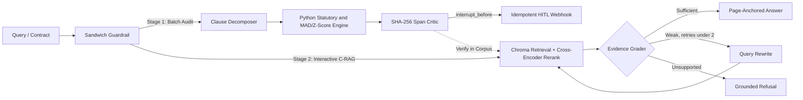

# VeriDoc

**An evidence-first Corrective RAG and deterministic compliance audit engine over Indian legal and corporate corpora.**

VeriDoc combines two connected workflows in a single workspace:
- **Stage 1 — Autonomous Contract & Invoice Audit (`Autonomous Audit`):** Decomposes vendor contracts and invoices into discrete clauses, routes numeric and Indian statutory checks (GSTIN Modulo-36 checksums, PAN format, SAC/HSN GST rates, Section 194C/194J/194I TDS, and Z-score/Median-MAD spend outliers) to deterministic Python validators, verifies 64-character SHA-256 span hashes, and pauses at a Human-in-the-Loop (`interrupt_before`) gate before dispatching idempotent redline webhooks.
- **Stage 2 — Corrective RAG Verification (`Ask the corpus`):** Answers legal and financial questions over 21,400+ indexed PDF/DOCX chunks. Clicking **Verify in Corpus** on any audit finding routes the clause into a LangGraph state machine that retrieves candidates from ChromaDB, reranks them with a local Cross-Encoder, rewrites weak queries up to 2 times, and refuses to answer when page-level proof is missing.

**Live application:** https://veridoc-phi.vercel.app

## Architecture



## Evaluation & Load Benchmarks

Measured via `backend/evaluate.py` and a local 50-request (200-clause) load benchmark on a single machine, plus a 16-question grounded Q&A check, a 16-clause Indian statutory ablation suite, and a 20-payload adversarial prompt-injection suite.

| Metric / Configuration | Baseline (Plain LLM) | C-RAG Only | VeriDoc Hybrid |
|---|---|---|---|
| Numeric & Statutory Error Rate | 37.5% (6/16) | 18.8% (3/16) | **0.0% (0/16)** |
| Clause Audit F1-Score | 40.0% | 76.9% | **100.0%** |
| Grounded Q&A Refusal Accuracy | n/a | 16 / 16 (100%) | **16 / 16 (100%)** |
| Deterministic Audit Latency (Cold p50 / Warm Cache) | 26,500 ms | 3,400 ms | **45.83 ms / 11.92 ms** |
| Load Latency (p50 / p95 / p99, 22.4 audits/s) | — | — | **25.79 ms / 76.11 ms / 115.47 ms** |
| Prompt Injection Defense (20 Attacks) | 0% | 85.0% (Input Edge) | **100.0% (Action Safety)** |

> Note: sub-100 ms figures cover the deterministic audit path (Python validators, SHA-256 cache, local reranking). LLM-backed Q&A in Stage 2 is bounded by the LLM provider's latency. Load figures come from a local benchmark, not production traffic.

- **Retrieval Corpus:** ~20,000 corporate/handbook chunks (`all-MiniLM-L6-v2`, 384-d) + ~1,400 Indian law chunks (`text-embedding-3-small`, 1536-d) reranked locally via `cross-encoder/ms-marco-MiniLM-L-6-v2` (~39.70 ms/clause at $0 API cost).
- **HITL & Idempotency Telemetry:** Webhook approval dispatches in `8.36 ms`, and duplicate replay attempts (`SKIPPED_DUPLICATE_IDEMPOTENT_REPLAY`) are blocked in `0.26 ms`.
- **Adversarial Failure Analysis:** 17/20 prompt injections are blocked at the input regex guardrail (85.0%). 3 obfuscated payloads (semantic CFO waiver note, Base64, leetspeak) bypass surface regexes and are neutralized by Python math isolation and the mandatory HITL approval breakpoint.

## Tech Stack

| Layer | Technology |
|---|---|
| Orchestration | LangGraph (`StateGraph`, `Send` fan-out, checkpointing, `interrupt_before` HITL) |
| Backend & API | Python 3.11, FastAPI, Pydantic v2, slowapi |
| Retrieval & Reranking | ChromaDB, Sentence Transformers (`all-MiniLM-L6-v2`, `ms-marco-MiniLM-L-6-v2`) |
| Deterministic Rules | Python `statistics` (Z-score, IQR, Median/MAD), Indian GSTIN/PAN/SAC/TDS validators |
| LLM Gateway | Groq (`Llama-3.3-70B`) & OpenRouter |
| Frontend & Cloud | React 19, TypeScript, Vite, Tailwind CSS, Docker, Google Cloud Run, Vercel |

## Quickstart

```bash
git clone https://github.com/amshutha07-cmd/VeriDoc.git
cd VeriDoc

# 1. Backend & Benchmark Suite
cd backend
python -m venv venv
source venv/bin/activate        # Windows: .\venv\Scripts\Activate.ps1
pip install -r requirements.txt
cp .env.example .env            # Add OPENROUTER_API_KEY and/or GROQ_API_KEY
python evaluate.py              # Run ablation & red-team benchmarks
uvicorn app.main:app --reload --port 8000

# 2. Frontend (second terminal)
cd ../dashboard
pnpm install
echo "VITE_VERIDOC_API_URL=http://localhost:8000" > .env.local
pnpm dev
```

Pre-built ChromaDB collections (`veridoc-index.zip`) and `graph_store.pkl` are available in the [latest release](https://github.com/amshutha07-cmd/VeriDoc/releases/latest).

## License

MIT. See [LICENSE](LICENSE).