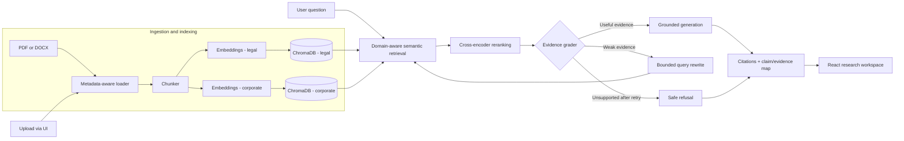

# VeriDoc Nexus

## Evidence-First Corrective RAG for Legal and Corporate Document Research

VeriDoc Nexus is an evidence-first Corrective Retrieval-Augmented Generation (RAG) research workspace. Instead of retrieving once and generating immediately, it evaluates the quality of its retrieved evidence, corrects weak searches through a bounded rewrite loop, reranks candidates with a cross-encoder, and grounds every answer in cited source passages - across two separate domains: Indian legal documents (Acts, Constitution, judgments) and corporate filings/handbooks.

**Repository:** [github.com/amshutha07-cmd/VeriDoc](https://github.com/amshutha07-cmd/VeriDoc)

**Status:** Fully working locally (backend + frontend), verified end-to-end. Not currently hosted live - see [Deployment status](#deployment-status) below for why.

## Why VeriDoc Nexus?

A fluent answer is not necessarily a supported one. Similarity search can return navigation fragments, boilerplate, or passages that are related but insufficient. VeriDoc Nexus makes the evidence boundary visible: every claim is traceable to a source passage, and the system is built around a claim -> evidence -> source chain rather than a single opaque answer box.

The system is designed around five goals:

- **Groundedness** - factual claims come from supplied document evidence, with page-level citations.
- **Auditability** - users can inspect the retrieval path, reranking scores, and cited sources.
- **Correction** - weak retrieval triggers a bounded query rewrite and retry.
- **Domain awareness** - legal and corporate corpora are retrieved, embedded, and graded separately.
- **Provenance** - every claim is anchored to a source passage before it reaches the answer (SHA-256 hashing preserved at ingestion).

## Architecture



## Workflow

1. The user opens the research workspace and submits a question, choosing (or auto-routing to) a domain - legal or corporate.
2. Domain-aware semantic retrieval pulls candidate chunks from the corresponding ChromaDB collection. A knowledge graph layer additionally narrows retrieval when the question names a specific Act, Article, or entity.
3. A cross-encoder reranks question-passage pairs, filters navigation/footer noise, and diversifies by source page.
4. The evidence grader determines whether the selected context actually supports the question.
5. If evidence is weak, a rewrite node generates a tighter retrieval query and retries within a bounded limit.
6. The generator answers only from supplied evidence and cites source + page for every claim.
7. If support is still insufficient, the system returns a safe refusal rather than guessing.
8. The React UI shows the answer, the reasoning trace, a claim/evidence relationship map, and expandable source passage cards.

## Features

- Two independently indexed domains: Indian legal corpus (Acts, Constitution - 1,400+ chunks) and corporate/handbook corpus.
- Knowledge graph layer covering the Forest Rights Act, Motor Vehicles Act, the Constitution (352 articles), and corporate filings, used to narrow retrieval for entity-specific questions.
- Recursive PDF/DOCX ingestion with page-aware metadata and SHA-256 provenance.
- Cross-encoder reranking for evidence precision, with query-aware section bonuses for domain-specific question types.
- LLM-based evidence grading with a bounded corrective rewrite loop.
- Grounded answer generation with inline source citations and page numbers.
- Safe refusal for questions unsupported by the indexed documents.
- Knowledge graph browse mode across both legal and corporate domains.
- Claim/evidence relationship mapping per query.
- Custom document upload and ingestion directly from the UI.
- Live reasoning trace (route query -> retrieve -> rerank -> grade -> generate).
- Copy-with-citations, expandable source passage cards, a working mobile navigation drawer, and a responsive research workspace.
- Deterministic evaluation harness comparing the corrective (CRAG) graph against a baseline graph on evidence coverage, answer coverage, and citation rate.

## Technology stack

| Layer | Technology |
| --- | --- |
| Backend language | Python, FastAPI |
| Workflow orchestration | LangGraph |
| Vector database | ChromaDB (separate collections per domain) |
| Reranking | Sentence Transformers cross-encoder, lazy-loaded |
| Language model access | OpenRouter / Gemini-compatible chat models |
| Document parsing | PyPDF and python-docx loaders |
| Frontend | React + TypeScript + Vite, Tailwind CSS |

## Repository structure

```
backend/
  app/
    main.py                       # FastAPI entrypoint - CORS, route wiring
    api/
      routes_ingest.py            # Document upload/ingestion endpoints
      routes_ask.py               # Question-answering (SSE) endpoint
      routes_graph.py             # Knowledge graph browse/search endpoints
      routes_eval.py              # Evaluation endpoints
    core/
      config.py                   # Settings (env-driven)
      state.py                    # Shared LangGraph state
    graph/
      build_graph.py              # LangGraph construction
      prompts.py                  # Evidence formatting helpers
      nodes/
        retrieve.py                # Domain-aware semantic retrieval
        graph_search.py            # Knowledge-graph-narrowed retrieval
        rerank.py                  # Cross-encoder precision layer (lazy-loaded)
        grade.py                   # Evidence grading
        rewrite.py                 # Bounded query rewriting
        generate.py                # Grounded generation and refusal
    ingestion/
      loader.py                   # PDF/DOCX loading and metadata
      chunker.py                  # Retrieval chunking
      embedder.py                 # Embedding factory (lazy-loaded)
      vector_store.py             # Chroma build/reopen
    legal_ingestion/
      build_a1988_graph.py        # Motor Vehicles Act graph builder
      build_constitution_graph.py # Constitution graph builder
      build_corporate_graph.py    # Corporate graph builder
      build_forest_rights_graph.py
  chroma_db/                      # Vector store (not committed)
  requirements.txt                # Python dependencies (CPU-only torch)

dashboard/client/
  src/
    pages/
      Home.tsx                    # Main research workspace - ask, citations, trace
      CorpusRegistry.tsx          # Indexed document registry
      KnowledgeGraph.tsx          # Graph browse mode
      IngestionJobs.tsx           # Upload/ingestion job status
      Evaluation.tsx              # Retrieval evaluation results
    components/
      ClaimEvidenceMap.tsx        # Claim/evidence relationship visualization
    App.tsx
```

## Running locally

**Backend:**

```powershell
cd backend
python -m venv .venv
.\.venv\Scripts\Activate.ps1
pip install -r requirements.txt --break-system-packages

# Set required environment variables (see .env.example / your own .env)
#   OPENROUTER_API_KEY, GOOGLE_API_KEY, EMBEDDING_PROVIDER, ALLOWED_ORIGINS

uvicorn app.main:app --reload --port 8000
```

Verify it's up: open `http://localhost:8000/docs`.

**Frontend:**

```powershell
cd dashboard/client
npm install
npm run dev
```

Set `VITE_VERIDOC_API_URL` in a `.env` file (or your shell) if the frontend needs to point at a non-default backend URL.

Never commit API keys, `.env` files, or secrets to the repository.

## Suggested demo questions

### Legal domain - supported

```
What does Article 21 of the Constitution say?
```

Expected behavior: retrieves and reranks relevant Constitution passages, grades them as useful, generates a cited answer referencing the specific article text and page numbers.

```
What is the necessity for permits under the Motor Vehicles Act?
```

Expected behavior: the knowledge graph layer narrows retrieval to the Motor Vehicles Act, and the final cited evidence lands on the relevant permit provisions.

### Corporate domain - supported

```
What are Apple's main risk factors?
```

Expected behavior: retrieves corporate filing sections, reranks with the risk-factor-aware scoring bonus, and returns a grounded, cited answer.

### Unsupported question

Ask something clearly outside the indexed corpus (e.g. a specific figure from a document that was never ingested). Expected behavior: bounded corrective retrieval attempts a rewrite, then returns a safe refusal rather than fabricating an answer.

## Evaluation results

The deterministic evaluation harness (`/eval/run`, `/eval/status`) compares the full Corrective RAG (CRAG) graph against a simple baseline graph (single retrieve-then-generate pass, no grading or correction) across a fixed set of 8 test questions spanning both domains. Results below are from a live local run, reproducible via the harness itself - not fabricated or hand-picked.

| Metric | Baseline | CRAG |
| --- | --- | --- |
| Evidence coverage | 0.529 | **0.571** |
| Answer coverage | 0.316 - 0.346 | **0.371 - 0.379** |
| Citation rate | 0.625 | **0.750** |
| Average retries | 0 | 0.375 |
| Average latency | ~3.2-3.4s | ~6.1-7.3s |

CRAG outperforms the baseline on every quality metric across repeated runs, most notably citation rate (+0.125). This comes at a latency cost roughly double the baseline, driven by the corrective rewrite loop (0.375 average retries per question) and the additional grading/reranking steps - the expected tradeoff of prioritizing grounded, cited answers over raw speed.

## Deployment status

CI/CD was explored but a live deployment was **not** pursued. During deployment testing, the backend consistently hit Render's free-tier 512MB RAM limit and was OOM-killed at startup, even after:

- Lazy-loading the Hugging Face embedding model (only imported when embeddings are actually requested).
- Lazy-loading the cross-encoder reranker via a cached singleton (only loads on first rerank call, not at import time).
- Forcing a CPU-only PyTorch build to eliminate unnecessary CUDA/GPU package downloads.

The root cause is the base import footprint of the ML stack itself (torch + transformers + sentence-transformers + chromadb + langchain/langgraph), which exceeds 512MB before any request is served. This is a resourcing constraint of free-tier hosting, not an application bug - a paid tier with more RAM, or splitting embeddings/reranking into a separate API-based service, would resolve it.

Given the scope of this as a portfolio project and time constraints ahead of placements, further deployment was deprioritized in favor of a fully working local setup, verified end-to-end, backed by a recorded demo walkthrough.

## Safety and limitations

VeriDoc Nexus is a portfolio research prototype, not a production multi-user document vault. Do not upload confidential, personal, regulated, or proprietary documents. A production version would require authentication, per-user document isolation, private object storage, hosted persistent vector storage with adequate memory provisioning, deletion controls, rate limiting, and stronger monitoring.

The generator treats document text as untrusted data rather than instructions - it is instructed to ignore document content that attempts to reveal secrets, change system rules, call tools, or answer beyond the retrieved evidence. Upload processing is bounded by file, page, and chunk limits.

The system does not claim universal accuracy or universal improvement over baseline RAG. Its main contribution is a reliability-oriented control layer: evidence grading, bounded correction, provenance, traceability, and safe refusal - across two independently maintained document domains.

## Project status

**Completed portfolio prototype**, fully functional locally. Multi-domain corpus (legal + corporate), working Corrective RAG graph with reranking, knowledge-graph-narrowed retrieval, and a bounded rewrite loop, custom upload flow, knowledge graph browse mode, claim/evidence mapping, live reasoning trace, and a deterministic evaluation harness showing CRAG outperforming the baseline graph on evidence coverage, answer coverage, and citation rate.

## Future enhancements

- Split embedding/reranking into a lightweight, API-based or separately-hosted service to fit free-tier memory limits, or move to a paid hosting tier.
- Add authentication and per-user/per-case document namespaces.
- Move uploaded files to private object storage.
- Use a hosted, persistent vector database with deletion and retention policies.
- Add server-side rate limiting and request quotas.
- Expand evaluation with answerable, unsupported, adversarial, multi-hop, and cross-domain test cases.
- Add automated prompt-injection, malformed-file, and resource-exhaustion tests.
- Add aggregate observability for latency, retries, refusal calibration, and cost.