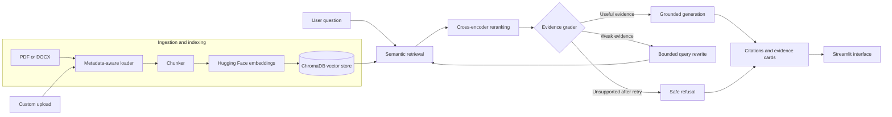

# VeriDoc

## Evidence-First Corrective RAG for Financial and Business Document QA

VeriDoc is an evidence-first Corrective Retrieval-Augmented Generation system for answering questions over financial, business, macroeconomic, and educational documents. Instead of retrieving once and generating immediately, VeriDoc evaluates the quality of its retrieved evidence, corrects weak searches through a bounded rewrite loop, and refuses unsupported questions rather than inventing facts.

**Live demo:** [proofloop.streamlit.app](https://proofloop.streamlit.app)**Repository:** [github.com/amshutha07-cmd/self](https://github.com/amshutha07-cmd/self)

## Why VeriDoc?

A fluent answer is not necessarily a supported answer. Similarity search can return navigation fragments, repeated boilerplate, or passages that are related but insufficient for the requested fact. VeriDoc makes the evidence boundary visible and treats refusal as a deliberate product behavior.

The system is designed around five goals:

- **Groundedness:** factual claims should come from supplied document evidence.

- **Auditability:** users can inspect the retrieval path and cited sources.

- **Correction:** weak retrieval can trigger a bounded query rewrite and retry.

- **Safety:** unsupported questions are refused or qualified.

- **Reusability:** the same workflow works across multiple document domains.

## Architecture



## Workflow

1. The user submits a question.

1. Semantic retrieval produces candidate chunks from ChromaDB.

1. A cross-encoder reranks question-passage pairs and filters retrieval noise.

1. The evidence grader determines whether the selected context is useful.

1. If evidence is weak, the rewrite node creates a concise retrieval query and retries within a bounded limit.

1. The generator answers only from supplied evidence and cites source/page metadata.

1. If support is insufficient, VeriDoc returns a safe refusal.

1. The Streamlit UI displays the answer, trace, support state, retries, confidence, and evidence cards.

## Features

- Multi-domain corpus covering corporate filings, macroeconomic reports, and educational references.

- Approximately 20k indexed vectors using local Hugging Face embeddings.

- Recursive PDF and DOCX ingestion with page-aware metadata.

- ChromaDB vector persistence and cloud bootstrap support.

- Cross-encoder reranking for improved evidence precision.

- LLM-based evidence grading with score and lexical guardrails.

- Bounded corrective query rewriting.

- Grounded answer generation with source and page citations.

- Safe refusal for questions unsupported by the indexed documents.

- Custom PDF/DOCX upload and indexing from the Streamlit interface.

- Live graph trace showing retrieval and correction stages.

## Technology stack

| Layer | Technology |
| --- | --- |
| Language | Python |
| Workflow orchestration | LangGraph |
| Embeddings | Local Hugging Face embeddings |
| Vector database | ChromaDB |
| Reranking | Sentence Transformers cross-encoder |
| Language model access | OpenRouter-compatible chat model |
| Document parsing | PyPDF and DOCX loaders |
| Interface | Streamlit |
| Deployment | Streamlit Community Cloud |

## Repository structure

```
streamlit_app.py                 # Public UI, upload flow, trace, evidence cards
render_fetch.py                  # Curated corpus bootstrap
app/
  api/                            # FastAPI route layer retained for local use
  core/                           # Settings and shared state
  graph/
    build_graph.py                # LangGraph construction
    prompts.py                    # Evidence formatting helpers
    nodes/
      retrieve.py                 # Semantic retrieval
      rerank.py                   # Cross-encoder precision layer
      grade.py                    # Evidence grading and metadata
      rewrite.py                  # Bounded query rewriting
      generate.py                 # Grounded generation and refusal
  ingestion/
    loader.py                     # PDF/DOCX loading and metadata
    chunker.py                    # Retrieval chunking
    embedder.py                   # Embedding factory
    vector_store.py               # Chroma build/reopen
requirements.txt                  # Python dependencies
```

## Running locally

```
python -m venv venv
.\venv\Scripts\Activate.ps1
python -m pip install -r requirements.txt

$env:EMBEDDING_PROVIDER = "huggingface"
$env:CHROMA_PERSIST_DIR = ".\chroma_db_hf"
$env:PYTHONIOENCODING = "utf-8"

streamlit run streamlit_app.py
```

For local execution, keep the OpenRouter key in a local environment or secrets file that is excluded from Git. Never place API keys in source code, screenshots, logs, or commits.

## Suggested demo questions

### Supported question

```
What are Apple's main risk factors?
```

Expected behavior: VeriDoc retrieves and reranks evidence, grades it as useful, generates a cited answer, and displays the retrieval trace and evidence cards.

### Unsupported question

```
What was Apple's exact stock buyback amount in Q3 2019?
```

Expected behavior: VeriDoc performs bounded corrective retrieval and refuses or qualifies the answer because the indexed evidence does not support that period.

### Custom document question

Upload a public, non-sensitive PDF or DOCX, select **Add document**, and ask a question whose answer is clearly contained in the file.

## Deployment

The application is deployed on Streamlit Community Cloud. The public app reads `OPENROUTER_API_KEY` from Streamlit Secrets and runs the graph directly inside the Streamlit process. This avoids the common mistake of making a public UI call a developer-only address such as `127.0.0.1:8000`.

Recommended Streamlit Secrets:

```
OPENROUTER_API_KEY = "your-key"
EMBEDDING_PROVIDER = "huggingface"
CHROMA_PERSIST_DIR = "./chroma_db_hf"
PYTHONIOENCODING = "utf-8"
```

## Safety and limitations

VeriDoc is a public portfolio prototype, not a private multi-user document vault. Do not upload confidential, personal, regulated, or proprietary documents. A production version would require authentication, per-user document isolation, private object storage, persistent hosted vector storage, deletion controls, rate limiting, and stronger monitoring.

The generator treats document text as untrusted data rather than instructions. It is instructed to ignore document content that asks it to reveal secrets, change system rules, call tools, or answer beyond the evidence. Upload processing is bounded by file, page, and chunk limits.

The system does not claim universal accuracy or universal improvement over baseline RAG. Its main contribution is a reliability-oriented control layer: evidence grading, bounded correction, provenance, traceability, and safe refusal.

## Project status

**Completed portfolio prototype.** The system has a multi-domain corpus, working Corrective RAG graph, custom upload flow, evidence trace UI, safe refusal behavior, security boundaries appropriate for a demo, and a public deployment.

## Future enhancements

- Add authentication and per-user document namespaces.

- Move uploaded files to private object storage.

- Use a hosted persistent vector database with deletion and retention policies.

- Add server-side rate limiting and request quotas.

- Expand evaluation with answerable, unsupported, adversarial, multi-hop, and cross-domain cases.

- Add automated prompt-injection, malformed-file, and resource-exhaustion tests.

- Add aggregate observability for latency, retries, refusal calibration, and cost.
