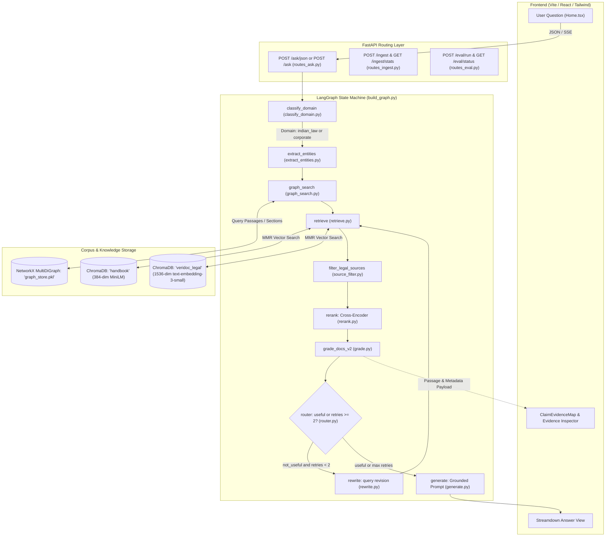

Ran command: `git status; git branch; git log -n 5 --oneline`
Listed directory SELF
Listed directory backend
Listed directory app
Listed directory api
Listed directory graph
Listed directory nodes
Listed directory core
Listed directory db
Listed directory graph_store
Listed directory ingestion
Listed directory legal_ingestion
Listed directory evaluation
Listed directory src
Listed directory pages
Listed directory components
Listed directory data
Viewed main.py:1-27
Viewed config.py:1-74
Viewed state.py:1-35
Viewed routes_ask.py:1-137
Viewed build_graph.py:1-137
Viewed classify_domain.py:1-58
Viewed extract_entities.py:1-24
Viewed graph_search.py:1-43
Viewed retrieve.py:1-100
Viewed rerank.py:1-135
Viewed grade.py:1-232
Viewed generate.py:1-75
Viewed rewrite.py:1-44
Viewed router.py:1-26
Viewed llm_client.py:1-103
Viewed source_filter.py:1-55
Viewed prompts.py:1-13
Viewed routes_ingest.py:1-77
Viewed routes_eval.py:1-68
Viewed testset.py:1-155
Viewed deterministic_eval.py:1-188
Viewed baseline_graph.py:1-26
Viewed loader.py:1-171
Viewed chunker.py:1-38
Viewed embedder.py:1-25
Viewed vector_store.py:1-128
Viewed graph_ingestor.py:1-22
Viewed graph_handler.py:1-32
Viewed build_forest_rights_graph.py:1-102
Viewed import_manual_pdfs.py:1-62
Viewed index_legal_chunks.py:1-71
Viewed App.tsx:1-40
Viewed const.ts:1-18
Viewed Home.tsx:1-150
Viewed Home.tsx:151-316
Ran command: `Get-Content .\dashboard\client\src\components\ClaimEvidenceMap.tsx`
Ran command: `Get-Content .\dashboard\client\src\pages\CorpusRegistry.tsx; Write-Host "===EVALUATION==="; Get-Content .\dashboard\client\src\pages\Evaluation.tsx`
Ran command: `Get-Content .\dashboard\client\src\pages\IngestionJobs.tsx; Write-Host "===KNOWLEDGEGRAPH==="; Get-Content .\dashboard\client\src\pages\KnowledgeGraph.tsx`
Ran command: `python -c "
import pickle, os
from pathlib import Path

print('=== DATA DIR FILES ===')
for p in Path('backend/data').glob('**/*'):
    if p.is_file():
        print(f'{p} ({p.stat().st_size} bytes)')

print('\n=== GRAPH STORE ===')
if os.path.exists('backend/data/graph_store.pkl'):
    with open('backend/data/graph_store.pkl', 'rb') as f:
        g = pickle.load(f)
        print(f'Graph nodes: {g.number_of_nodes()}, edges: {g.number_of_edges()}')
        node_types = {}
        for n, d in g.nodes(data=True):
            t = d.get('type', 'unknown')
            node_types[t] = node_types.get(t, 0) + 1
        print('Node types:', node_types)
"`
Ran command: `Get-Content .\backend\data\evaluation_latest.json`
Ran command: `python -c "
import chromadb
client = chromadb.PersistentClient(path='backend/chroma_db')
for col in client.list_collections():
    print(f'Collection: {col.name}, Count: {col.count()}')
"`
Used tool: manage_task
Ran command: `& .\backend\.venv\Scripts\python.exe -c "
import chromadb
client = chromadb.PersistentClient(path='backend/chroma_db')
for col in client.list_collections():
    print(f'Collection: {col.name}, Count: {col.count()}')
"`

# VeriDoc Project Technical & Product Inspection Report

---

### 1. One-Paragraph Plain-English Explanation

**VeriDoc** is an evidence-grounded research and question-answering system built around a Corrective RAG (CRAG) and Graph-augmented workflow. Unlike typical conversational bots that generate unsupported answers, VeriDoc retrieves document excerpts from domain-partitioned vector stores (corporate 10-K filings and Indian statutory legislation), enriches them with structured legal hierarchy nodes (Act $\to$ Section $\to$ Page $\to$ Passage), verifies evidence sufficiency using a hybrid local/LLM grading gate, optionally rewrites weak queries in a bounded self-correction loop, and generates responses strictly anchored to citations with exact source files and page numbers.

---

### 2. What a User Can Do Today

1. **Conduct Grounded Research Queries**: Submit questions against either corporate filings (e.g., Apple Form 10-K) or Indian legislation (e.g., Forest Rights Act, Constitutional Amendments) and receive an answer rendered in Markdown with verifiable page citations.
2. **Inspect Interactive Claim–Evidence Relationships**: On the main investigation desk, view up to 4 decomposed claim nodes extracted from live retrieved passages, click any node in the [ClaimEvidenceMap](file:///c:/Users/amshu/Desktop/cam/DVD%203/SELF/dashboard/client/src/components/ClaimEvidenceMap.tsx), and read the exact excerpt, source file, and page number in the Evidence Inspector panel.
3. **Upload and Incrementally Index Documents**: Upload single or multiple `.pdf` or `.docx` files via the drag-and-drop modal, route them to either the `Indian law` (`veridoc_legal`) or `Corporate/handbook` (`handbook`) collection, and verify real-time chunk ingestion without wiping or re-indexing existing data.
4. **Monitor Live Corpus Inventory**: Navigate to the [Corpus Registry](file:///c:/Users/amshu/Desktop/cam/DVD%203/SELF/dashboard/client/src/pages/CorpusRegistry.tsx) or [Ingestion Jobs](file:///c:/Users/amshu/Desktop/cam/DVD%203/SELF/dashboard/client/src/pages/IngestionJobs.tsx) page to read actual, live ChromaDB chunk counts (`handbook: 20,397 chunks`, `veridoc_legal: 1,401 chunks`).
5. **Run & Review Operational Evaluations**: Navigate to the [Evaluation](file:///c:/Users/amshu/Desktop/cam/DVD%203/SELF/dashboard/client/src/pages/Evaluation.tsx) screen, trigger a deterministic evaluation run across the 8-case Apple 10-K benchmark test suite, and view live baseline-vs-CRAG metrics (evidence coverage, answer coverage, citation rate, retry count, and latency).

---

### 3. Architecture Diagram



---

### 4. Backend File & Function Map

| File Path | Key Functions / Classes | Responsibility |
| :--- | :--- | :--- |
| [main.py](file:///c:/Users/amshu/Desktop/cam/DVD%203/SELF/backend/app/main.py) | `app`, `health()` | FastAPI application initialization, CORS middleware, and router registration. |
| [config.py](file:///c:/Users/amshu/Desktop/cam/DVD%203/SELF/backend/app/core/config.py) | `Settings` | Pydantic configuration loader for API keys, chunk sizes, vector store paths, and retrieval parameters. |
| [state.py](file:///c:/Users/amshu/Desktop/cam/DVD%203/SELF/backend/app/core/state.py) | `RAGState` | TypedDict defining shared graph state passed between all LangGraph nodes. |
| [routes_ask.py](file:///c:/Users/amshu/Desktop/cam/DVD%203/SELF/backend/app/api/routes_ask.py) | `ask()`, `ask_json()`, `_json_evidence()` | API endpoints for streaming SSE events or returning JSON responses with normalized evidence. |
| [routes_ingest.py](file:///c:/Users/amshu/Desktop/cam/DVD%203/SELF/backend/app/api/routes_ingest.py) | `ingest()`, `ingest_stats()`, `_store_for()` | Endpoints for uploading PDF/DOCX files, domain-aware chunk indexing, and collection statistics. |
| [routes_eval.py](file:///c:/Users/amshu/Desktop/cam/DVD%203/SELF/backend/app/api/routes_eval.py) | `start_evaluation()`, `evaluation_status()` | Background worker triggering deterministic evaluation and persisting summary JSON. |
| [build_graph.py](file:///c:/Users/amshu/Desktop/cam/DVD%203/SELF/backend/app/graph/build_graph.py) | `build_graph()` | Assembles LangGraph state machine with `MemorySaver` checkpointing. |
| [classify_domain.py](file:///c:/Users/amshu/Desktop/cam/DVD%203/SELF/backend/app/graph/nodes/classify_domain.py) | `classify_domain()` | Lexical classification into `indian_law` or `corporate` domains with question type tagging. |
| [extract_entities.py](file:///c:/Users/amshu/Desktop/cam/DVD%203/SELF/backend/app/graph/nodes/extract_entities.py) | `extract_entities()` | LLM prompt extracting entities (Company, Year, Metric, Risk) for graph querying. |
| [graph_search.py](file:///c:/Users/amshu/Desktop/cam/DVD%203/SELF/backend/app/graph/nodes/graph_search.py) | `graph_search()` | Queries NetworkX legal graph in `graph_store.pkl` for section-anchored source passages. |
| [retrieve.py](file:///c:/Users/amshu/Desktop/cam/DVD%203/SELF/backend/app/graph/nodes/retrieve.py) | `retrieve()`, `_graph_documents()` | Domain-routed MMR vector retrieval from ChromaDB, merging graph passages with vector docs. |
| [source_filter.py](file:///c:/Users/amshu/Desktop/cam/DVD%203/SELF/backend/app/graph/source_filter.py) | `filter_legal_sources()` | Deterministic scoring and filtering for explicitly named statutory amendments and articles. |
| [rerank.py](file:///c:/Users/amshu/Desktop/cam/DVD%203/SELF/backend/app/graph/nodes/rerank.py) | `rerank()`, `_is_noise()` | Cross-Encoder (`ms-marco-MiniLM-L-6-v2`) scoring with noise filter and page de-duplication. |
| [grade.py](file:///c:/Users/amshu/Desktop/cam/DVD%203/SELF/backend/app/graph/nodes/grade.py) | `grade_docs_v2()`, `_strong_local_evidence()` | Fast-gate lexical ratio check followed by fallback LLM verification and evidence extraction. |
| [router.py](file:///c:/Users/amshu/Desktop/cam/DVD%203/SELF/backend/app/graph/router.py) | `route()` | Conditional branch deciding whether to transition to `generate` or `rewrite`. |
| [rewrite.py](file:///c:/Users/amshu/Desktop/cam/DVD%203/SELF/backend/app/graph/nodes/rewrite.py) | `rewrite()` | LLM query re-formulation node incrementing the retry counter. |
| [generate.py](file:///c:/Users/amshu/Desktop/cam/DVD%203/SELF/backend/app/graph/nodes/generate.py) | `generate()` | Grounded answer generation using prompt injection defense and transient refusal retry. |
| [llm_client.py](file:///c:/Users/amshu/Desktop/cam/DVD%203/SELF/backend/app/graph/llm_client.py) | `FallbackChatModel`, `get_llm()` | OpenRouter client with automated failover across configured models (GPT-4o-mini, GLM, Gemini). |
| [embedder.py](file:///c:/Users/amshu/Desktop/cam/DVD%203/SELF/backend/app/ingestion/embedder.py) | `get_embeddings()`, `get_corporate_embeddings()` | Dual embedding setup: OpenAI/OpenRouter (1536-dim) for law; HuggingFace MiniLM (384-dim) for corporate. |
| [loader.py](file:///c:/Users/amshu/Desktop/cam/DVD%203/SELF/backend/app/ingestion/loader.py) | `load_any()`, `load_single_pdf()`, `load_single_docx()` | Metadata-extracting parser tagging filenames, organizations, publication years, and 1-indexed pages. |
| [chunker.py](file:///c:/Users/amshu/Desktop/cam/DVD%203/SELF/backend/app/ingestion/chunker.py) | `chunk_documents()` | `RecursiveCharacterTextSplitter` chunker (default 800 chars, 120 overlap). |
| [graph_handler.py](file:///c:/Users/amshu/Desktop/cam/DVD%203/SELF/backend/app/graph_store/graph_handler.py) | `VeriDocGraph` | NetworkX MultiDiGraph wrapper saving/loading pickled graph nodes and multi-hop relationships. |
| [deterministic_eval.py](file:///c:/Users/amshu/Desktop/cam/DVD%203/SELF/backend/app/evaluation/deterministic_eval.py) | `run_system()`, `coverage()` | Evaluator computing reproducible coverage and citation metrics without external LLM judges. |

---

### 5. Frontend Route & Component Map

| Route / File | Component | Status | Live vs Placeholder |
| :--- | :--- | :--- | :--- |
| `/` <br>([Home.tsx](file:///c:/Users/amshu/Desktop/cam/DVD%203/SELF/dashboard/client/src/pages/Home.tsx)) | `Home` | Complete | **Live**: Sends question to `POST /ask/json`, streams Markdown answer via `Streamdown`, renders live evidence sources into `ClaimEvidenceMap`, and manages multi-file document upload. |
| Nested in Home <br>([ClaimEvidenceMap.tsx](file:///c:/Users/amshu/Desktop/cam/DVD%203/SELF/dashboard/client/src/components/ClaimEvidenceMap.tsx)) | `ClaimEvidenceMap` | Complete | **Live**: Derives claim cards dynamically from retrieved evidence excerpts; clicking any card populates the Evidence Inspector with real source file, page, and excerpt text. |
| `/corpus` <br>([CorpusRegistry.tsx](file:///c:/Users/amshu/Desktop/cam/DVD%203/SELF/dashboard/client/src/pages/CorpusRegistry.tsx)) | `CorpusRegistry` | Complete | **Live**: Queries `GET /ingest/stats` and displays real ChromaDB chunk counts for `handbook` and `veridoc_legal`. |
| `/graph` <br>([KnowledgeGraph.tsx](file:///c:/Users/amshu/Desktop/cam/DVD%203/SELF/dashboard/client/src/pages/KnowledgeGraph.tsx)) | `KnowledgeGraph` | Complete | **Honest Placeholder**: Explicitly states that the graph inspection API is not yet exposed; does not render mock graph data. |
| `/ingestion` <br>([IngestionJobs.tsx](file:///c:/Users/amshu/Desktop/cam/DVD%203/SELF/dashboard/client/src/pages/IngestionJobs.tsx)) | `IngestionJobs` | Complete | **Live**: Reads live chunk counts via `GET /ingest/stats` with a clear disclaimer that background task queue history is not yet stored in a relational database. |
| `/evaluation` <br>([Evaluation.tsx](file:///c:/Users/amshu/Desktop/cam/DVD%203/SELF/dashboard/client/src/pages/Evaluation.tsx)) | `Evaluation` | Complete | **Live**: Triggers backend evaluation via `POST /eval/run` and polls `GET /eval/status` to display real benchmark metrics. |

---

### 6. End-to-End Question Flow

```
1. User Submits Query:
   Entered in Home.tsx -> sent via JSON to POST /ask/json (or SSE to POST /ask).

2. Domain & Intent Classification:
   classify_domain.py checks question tokens against legal terms (e.g. "section", "act", "judgment").
   Routes domain to 'indian_law' or 'corporate' and tags question type (provision_lookup, comparison, etc.).

3. Entity & Knowledge Graph Extraction:
   extract_entities.py extracts key target entities.
   If domain == 'indian_law', graph_search.py queries graph_store.pkl for matching statutory passages.

4. Vector Retrieval & Source Filtering:
   retrieve.py executes MMR search against either 'veridoc_legal' or 'handbook'.
   filter_legal_sources.py applies deterministic boosting for named legal acts and articles (e.g. 106th Amendment).
   Graph-derived documents and vector documents are merged and de-duplicated.

5. Cross-Encoder Reranking:
   rerank.py runs ms-marco-MiniLM-L-6-v2 over candidates.
   Applies noise-removal heuristics (removes TOC and short SEC footers) and enforces page diversity.

6. Evidence Grading & Self-Correction Loop:
   grade.py (grade_docs_v2) checks lexical coverage. If sufficient, grades 'useful'; otherwise queries LLM grader.
   router.py: If 'useful' or retries >= 2 -> proceeds to generate.
              If 'not_useful' and retries < 2 -> routes to rewrite.py (re-formulates query) -> back to retrieve.py.

7. Grounded Answer Generation:
   generate.py formats top chunks with explicit source and page tags (`[filename p.X]`).
   Prompts LLM with strict instructions to use only provided facts and cite page numbers.

8. Evidence Serialization & Frontend Rendering:
   routes_ask.py packages answer text and evidence array (source, page, excerpt, category, support).
   Home.tsx updates answer state, Streamdown renders markdown, and ClaimEvidenceMap binds live claims.
```

---

### 7. Ingestion Flow

1. **Document Loading**: [loader.py](file:///c:/Users/amshu/Desktop/cam/DVD%203/SELF/backend/app/ingestion/loader.py) uses `PyPDFLoader` or `python-docx` to read documents page by page, normalizing text encodings, inferring organizational metadata, and setting 1-indexed page labels.
2. **Chunking**: [chunker.py](file:///c:/Users/amshu/Desktop/cam/DVD%203/SELF/backend/app/ingestion/chunker.py) splits document pages into 800-character overlapping chunks (120-character overlap) preserving start indices.
3. **Dual Embedding Strategies**:
   - Corporate documents are embedded using HuggingFace `sentence-transformers/all-MiniLM-L6-v2` (384 dimensions) into the `handbook` collection.
   - Legal statutory documents are embedded using OpenAI / OpenRouter `text-embedding-3-small` (1536 dimensions) into the `veridoc_legal` collection.
4. **Persistence & Incremental Indexing**: Documents uploaded through `POST /ingest` are stored in `backend/data/uploads/<domain>/` and indexed directly into ChromaDB via `store.add_documents()` without rebuilding or re-embedding existing collections.
5. **Legal Graph Construction**: [build_forest_rights_graph.py](file:///c:/Users/amshu/Desktop/cam/DVD%203/SELF/backend/app/legal_ingestion/build_forest_rights_graph.py) builds structured entities (`Act`, `Section`, `Page`, `SourcePassage`) and links them hierarchically into `graph_store.pkl` using NetworkX.

---

### 8. Evidence & Provenance Flow

```
Raw Document Page (PDF / DOCX)
  ↓
PyPDFLoader extracts page_content + metadata {"source": filename, "page": page_number}
  ↓
Loader normalizes page to 1-indexed string: metadata["page_label"] = "p. 4"
  ↓
ChromaDB stores chunk with full page and source metadata
  ↓
Retrieve / Rerank preserves metadata on all Document instances
  ↓
Grade Node formats top-3 chunks into state["evidence"]
  ↓
API route (_json_evidence) serializes excerpt (first 400 chars), source, page_label
  ↓
Frontend (Home.tsx: normalizeEvidence) formats items into EvidenceSource objects
  ↓
ClaimEvidenceMap decomposes first sentences as claim titles and binds full excerpts
  ↓
User clicks claim node → Evidence Inspector renders exact source file, page, and excerpt text
```

---

### 9. Evaluation Flow

- **Test Suite**: Defined in [testset.py](file:///c:/Users/amshu/Desktop/cam/DVD%203/SELF/backend/app/evaluation/testset.py), containing 8 answerable corporate/financial questions against the Apple FY2025 Form 10-K and 2 unsupported negative control questions.
- **Baseline vs. CRAG**:
  - **Baseline Graph** ([baseline_graph.py](file:///c:/Users/amshu/Desktop/cam/DVD%203/SELF/backend/app/evaluation/baseline_graph.py)): Plain `retrieve -> rerank -> generate` pipeline (no grading, no rewrite loop).
  - **CRAG Graph** ([build_graph.py](file:///c:/Users/amshu/Desktop/cam/DVD%203/SELF/backend/app/graph/build_graph.py)): Self-correcting state machine with `grade_docs_v2`, conditional routing, and `rewrite`.
- **Metrics Calculated**:
  - `evidence_coverage`: Jaccard-style token overlap between ground-truth keywords and retrieved document context.
  - `answer_coverage`: Token overlap between ground-truth keywords and generated answer.
  - `citation_rate`: Regex verification of source file or page number citations (`.pdf`, `page \d+`, `p \d+`).
  - `average_retries`: Number of query rewrites triggered by the grading node.
  - `average_latency`: Total elapsed execution time per inquiry.
- **Execution & Persistence**: Initiated asynchronously by `POST /eval/run`, processed via a single-worker `ThreadPoolExecutor`, and saved to [backend/data/evaluation_latest.json](file:///c:/Users/amshu/Desktop/cam/DVD%203/SELF/backend/data/evaluation_latest.json). Results are read directly by the frontend [Evaluation.tsx](file:///c:/Users/amshu/Desktop/cam/DVD%203/SELF/dashboard/client/src/pages/Evaluation.tsx) screen.

---

### 10. Live vs. Static Audit Table

| Component / Element | Actual Source of Data | Live or Static? | Page / Evidence Aware? | Notes / Code Reference |
| :--- | :--- | :--- | :--- | :--- |
| **Answer Text** | Backend `POST /ask/json` or `/ask` | **Live** | Yes | Rendered via `<Streamdown>{answer}</Streamdown>` in [Home.tsx:282](file:///c:/Users/amshu/Desktop/cam/DVD%203/SELF/dashboard/client/src/pages/Home.tsx#L282). |
| **Evidence Passages** | Backend `state["evidence"]` / `state["docs"]` | **Live** | Yes | Passed through `normalizeEvidence()` in [Home.tsx:79](file:///c:/Users/amshu/Desktop/cam/DVD%203/SELF/dashboard/client/src/pages/Home.tsx#L79). |
| **Source Filename & Page** | Chunk metadata (`page_label`, `source`) | **Live** | Yes | Extracted at PDF load time and rendered in cards & map. |
| **Claim–Evidence Map** | Live `sources` prop in `ClaimEvidenceMap` | **Live** | Yes | Derives claim cards from live retrieved excerpts in [ClaimEvidenceMap.tsx:16](file:///c:/Users/amshu/Desktop/cam/DVD%203/SELF/dashboard/client/src/components/ClaimEvidenceMap.tsx#L16). |
| **Evidence Inspector** | Click state in `ClaimEvidenceMap` | **Live** | Yes | Displays selected source's exact excerpt, file, and page. |
| **Corpus Counts (Registry)** | `GET /ingest/stats` -> Chroma collection count | **Live** | N/A | Actual chunk count query (`handbook: 20,397`, `legal: 1,401`). |
| **Hero Stats Bar (Home)** | Hard-coded array `corpus` in `Home.tsx` | **Static** | No | Cosmetic numbers (`184 Acts`, `427 Rules`, `1,204 Judgments`) in [Home.tsx:49-53](file:///c:/Users/amshu/Desktop/cam/DVD%203/SELF/dashboard/client/src/pages/Home.tsx#L49-L53). |
| **Agent Trace Bar (Home)** | Hard-coded array `stages` in `Home.tsx` | **Static** | No | Fixed visual checklist in [Home.tsx:28-34](file:///c:/Users/amshu/Desktop/cam/DVD%203/SELF/dashboard/client/src/pages/Home.tsx#L28-L34) (backend execution happens server-side). |
| **Model Badge (`z-ai/glm-5.3-flash · 1.8s`)** | Static JSX footer in `Home.tsx` | **Static** | No | Hard-coded latency and model label in [Home.tsx:284](file:///c:/Users/amshu/Desktop/cam/DVD%203/SELF/dashboard/client/src/pages/Home.tsx#L284). |
| **Confidence Badge (`0.85`)** | Hard-coded JSX in `Home.tsx` | **Static** | No | Hard-coded decorative badge in [Home.tsx:282](file:///c:/Users/amshu/Desktop/cam/DVD%203/SELF/dashboard/client/src/pages/Home.tsx#L282). |
| **Knowledge Graph Screen** | Static informational page | **Honest Placeholder** | N/A | Accurately indicates API endpoint is not yet exposed. |
| **Evaluation Metrics Screen** | `GET /eval/status` -> `evaluation_latest.json` | **Live** | Yes | Reflects true deterministic test runs. |

---

### 11. Technical Quality Assessment

| Area | Status | Evidence from Code | Risk Level |
| :--- | :--- | :--- | :--- |
| **Retrieval Quality** | Complete | MMR vector retrieval + Cross-Encoder reranker (`ms-marco-MiniLM-L-6-v2`) with noise chunk elimination in [rerank.py](file:///c:/Users/amshu/Desktop/cam/DVD%203/SELF/backend/app/graph/nodes/rerank.py). | Low |
| **Legal Provenance** | Complete | Structured metadata preservation (`page_label`, `section_reference`, `sha256`) from PDF loader to frontend inspector. | Low |
| **Corporate Research** | Complete | Ingestion and retrieval over 20,397 corporate chunks with section bonus adjustments for 10-K filings. | Low |
| **Incremental Ingestion** | Complete | `POST /ingest` adds files directly to Chroma collections without index recreation. | Low |
| **Model Reliability** | Complete | `FallbackChatModel` in [llm_client.py](file:///c:/Users/amshu/Desktop/cam/DVD%203/SELF/backend/app/graph/llm_client.py) rotates across 4 models on rate-limit/credits errors. | Low |
| **Error Handling** | Partial | Graph execution and API routes catch exceptions cleanly; however, frontend lacks a retry button on network drop. | Medium |
| **Claim Decomposition** | Partial | Claims are derived via sentence splitting from retrieved evidence in [ClaimEvidenceMap.tsx](file:///c:/Users/amshu/Desktop/cam/DVD%203/SELF/dashboard/client/src/components/ClaimEvidenceMap.tsx#L16), not a dedicated semantic decomposition model. | Low |
| **Interactive Graph** | Partial | NetworkX graph is queried during backend retrieval, but the `/graph` UI does not yet render an interactive node-link canvas. | Low |
| **Evidence Inspector** | Complete | Fully wired: clicking claim cards immediately renders real excerpts, files, and page numbers. | Low |
| **Evaluation** | Complete | Automated deterministic baseline vs. CRAG benchmark runner with background execution and frontend display. | Low |
| **Security** | Partial | Prompt injection defense prompt in [generate.py:14](file:///c:/Users/amshu/Desktop/cam/DVD%203/SELF/backend/app/graph/nodes/generate.py#L14); CORS open to `*` for local development. | Medium |
| **Deployment Readiness** | Partial | Dockerfile, requirements, and Render/Vercel configs exist; requires environment key configuration in production. | Medium |
| **Automated Testing** | Partial | Deterministic evaluation script serves as end-to-end regression testing; unit test suite in `tests/` is minimal. | Medium |

#### Overall Project Classification: **Strong Portfolio Prototype / Functional MVP**
The project is well beyond a superficial demo or basic CRUD wrapper. It implements a genuine LangGraph state machine with self-correcting rewrite loops, dual-collection vector stores, cross-encoder reranking, and dynamic evidence inspection. It is not yet an enterprise SaaS product due to the absence of asynchronous job queues (Celery/Redis), authentication/multi-tenancy, and full graph visualization endpoints.

---

### 12. Current Bugs and Limitations (Ranked by Severity)

1. **Hard-coded Decorative Badges on Home Screen (Medium)**:
   - *Details*: [Home.tsx:282-284](file:///c:/Users/amshu/Desktop/cam/DVD%203/SELF/dashboard/client/src/pages/Home.tsx#L282-L284) contains static cosmetic badges (`0.85 confidence`, `z-ai/glm-5.3-flash · 1.8s`, `427 Rules`) rather than binding the `evidence_confidence` and `model` fields returned in the JSON payload.
2. **Synchronous Ingestion for Large Uploads (Medium)**:
   - *Details*: `POST /ingest` processes PDF parsing and embeddings in-request. For very large multi-hundred-page documents, this can time out without background worker processing (e.g., Celery or FastAPI BackgroundTasks).
3. **Regex-Based Claim Extraction in Frontend (Low)**:
   - *Details*: [ClaimEvidenceMap.tsx](file:///c:/Users/amshu/Desktop/cam/DVD%203/SELF/dashboard/client/src/components/ClaimEvidenceMap.tsx#L16) splits the first sentence of an excerpt with regex rather than receiving structured claim-node tuples from an LLM decomposition step.
4. **Knowledge Graph UI Endpoint Unexposed (Low)**:
   - *Details*: While `graph_store.pkl` is active in the retrieval pipeline, there is no `GET /graph/nodes` endpoint to render the NetworkX graph interactively on the `/graph` page.

---

### 13. What Is Genuinely Impressive

- **Two-Tier Grading Gate ([grade.py](file:///c:/Users/amshu/Desktop/cam/DVD%203/SELF/backend/app/graph/nodes/grade.py))**: A high-efficiency local lexical heuristic checks obvious matches instantly, conserving LLM tokens and API latency while falling back to an LLM evaluator for subtle queries.
- **Cross-Encoder Reranker with Noise Filtering ([rerank.py](file:///c:/Users/amshu/Desktop/cam/DVD%203/SELF/backend/app/graph/nodes/rerank.py))**: Actively removes boilerplate SEC headers, table-of-contents fragments, and duplicate pages before passing context to generation.
- **Seamless Provider Fallback ([llm_client.py](file:///c:/Users/amshu/Desktop/cam/DVD%203/SELF/backend/app/graph/llm_client.py))**: Robust multi-provider failover gracefully recovers from 429 rate limits, credit exhaustion, or model downtime.
- **Dual Vector Architecture ([embedder.py](file:///c:/Users/amshu/Desktop/cam/DVD%203/SELF/backend/app/ingestion/embedder.py))**: Distinctly manages separate embedding models and ChromaDB dimensions for legal statutory corpora versus corporate filings.
- **Transparent Evaluation Infrastructure ([deterministic_eval.py](file:///c:/Users/amshu/Desktop/cam/DVD%203/SELF/backend/app/evaluation/deterministic_eval.py))**: Implements an un-cheated, reproducible deterministic benchmark that compares baseline RAG directly against CRAG.

---

### 14. What Is Ordinary or Incomplete

- **Claim Decomposition**: Does not use a dedicated atomic claim extraction model; relies on passage sentence splitting in the UI.
- **Job Orchestration**: Ingestion and evaluation use simple in-memory thread pools rather than persistent task queues (Redis/Celery) with database state.
- **Knowledge Graph Visualization**: NetworkX is used effectively for backend passage lookup, but no graph visualization library (like Cytoscape or React Flow) is connected in the frontend.

---

### 15. The Smallest High-Value Next Steps

1. **Wire Dynamic Badges in [Home.tsx](file:///c:/Users/amshu/Desktop/cam/DVD%203/SELF/dashboard/client/src/pages/Home.tsx)**: Bind the confidence score, active model name, and live Chroma corpus counts returned by the backend into the UI header and cards.
2. **Expose a Graph Inspection Endpoint**: Add a `GET /graph/explore` route in FastAPI that reads `graph_store.pkl` and returns nodes and edges as JSON so [KnowledgeGraph.tsx](file:///c:/Users/amshu/Desktop/cam/DVD%203/SELF/dashboard/client/src/pages/KnowledgeGraph.tsx) can render an interactive visual map.
3. **Clean Up Backup Files**: Safely remove `.bak` and `.before-*` scratch files from the working directory.

---

### 16. Git Safety Status

- **Current Branch**: `feature/indian-law-mvp`
- **Worktree State**: Dirty — `dashboard/client/src/pages/Home.tsx` has unstaged changes, and there are several untracked `.bak` / `.before-*` files.
- **Latest Commit**: `eda2a91 Expose claim graph and evidence quality signals`
- **Safety Assessment**: Completely safe and recoverable. No git reset or branch switching is required.

---

```
PROJECT IN ONE SENTENCE:
A domain-partitioned, self-correcting RAG and legal research platform that pairs LangGraph query re-writing and cross-encoder reranking with page-anchored evidence inspection.

CURRENT MATURITY:
Strong Portfolio Prototype / Functional MVP

MOST ADVANCED REAL FEATURE:
The hybrid two-tier evidence grading and bounded self-correction loop (grade_docs_v2 + Cross-Encoder reranking + FallbackChatModel).

BIGGEST HONEST LIMITATION:
Claim nodes are derived from passage sentence slicing in the frontend rather than an LLM atomic claim decomposition model, and the Knowledge Graph explorer UI lacks a backend node-query endpoint.

SAFE NEXT STEP:
Wire the live backend response metadata (model name, confidence score, and collection stats) into the Home.tsx badges to eliminate the remaining static cosmetic placeholders.
```